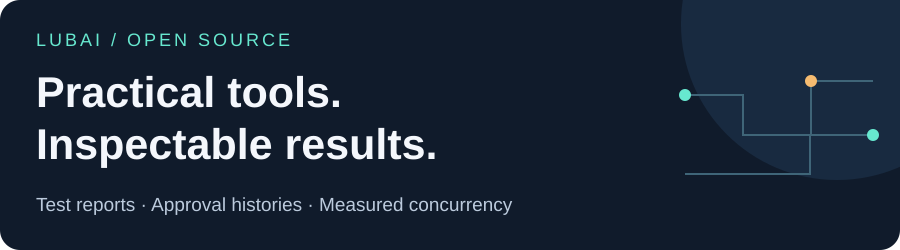

# Hi, I'm Lubai

I build inspectable developer tools and contribute fixes upstream. My current projects help make subtle regressions visible: duplicate test identities, lost approval state, and calls that do not overlap as intended.

[Explore the tools](#choose-a-tool) · [See upstream contributions](#selected-upstream-contributions) · [Report a reproducible problem](#working-with-these-projects)

## Choose a tool

### 01 / Test-report integrity

**[junit-collision-check](https://github.com/sunxiuguo/junit-collision-check)** — Find duplicate JUnit test identities across shards and retries, including conflicting outcomes a report consumer could hide.

For teams combining XML reports in CI. Python 3.12+ with Expat 2.6.0+.

[Listed in awesome-testing under Test Report Diagnostics](https://github.com/TheJambo/awesome-testing/blob/1dd0a3270b7465af010207692c0a8ea63866c2fe/README.md#test-report-diagnostics).

[Broken/control demo](https://github.com/sunxiuguo/junit-collision-check#try-the-failure-in-30-seconds) · [pytest CI integration](https://github.com/sunxiuguo/junit-collision-check/tree/master/examples/pytest-ci) · [Input/output contract](https://github.com/sunxiuguo/junit-collision-check/blob/master/docs/contract.md)

*A collision-free result is not a passing test run. Keep the test runner's failure gate.*

### 02 / Approval-history integrity

**[approval-history-kit](https://github.com/sunxiuguo/approval-history-kit)** — Check saved AI SDK approval histories and compare approval metadata before and after a declared lossless save/reload.

For application developers testing persistence. TypeScript library and CLI; Node.js 22/24; adapter pinned to ai@7.0.127 JSON ModelMessage.

[Save/reload regression demo](https://github.com/sunxiuguo/approval-history-kit/blob/master/examples/save-reload-regression.md) · [Choose a checkpoint](https://github.com/sunxiuguo/approval-history-kit#choose-the-checkpoint-you-actually-saved) · [Release archive](https://github.com/sunxiuguo/approval-history-kit/releases/tag/v0.1.0)

*History integrity is not authorization, provider acceptance, or validation of arbitrary conversation formats.*

### 03 / Observed concurrency

**[fanout-check](https://github.com/sunxiuguo/fanout-check)** — Check whether explicitly grouped tool or subagent calls overlap, using same-clock recorded intervals and a timing contract.

For developers adding regression checks to async workflows. Python 3.10+.

[Blocking/cooperative demo](https://github.com/sunxiuguo/fanout-check#try-it-in-a-checkout) · [Agents SDK component example](https://github.com/sunxiuguo/fanout-check/tree/master/examples/agents-sdk-regression) · [Trace format](https://github.com/sunxiuguo/fanout-check/blob/master/docs/format.md)

*Overlap does not establish correct outputs, safe independence, or end-to-end speedup.*

All three are early-stage, MIT-licensed tools with runnable synthetic examples. They run locally without API keys or a hosted service. Start from each repository's source or GitHub release instructions; no npm/PyPI publication is assumed.

## Experimental conversational UI

**[DSH A2UI](https://github.com/sunxiuguo/dsh-a2ui)** · Development preview **0.1.0-alpha.13**. An independent DeepSeek Harness plugin that renders A2UI forms and sends their actions into the next conversation turn.

For developers exploring conversational interfaces on **DSH 0.2.0-rc.2 / Cordis 4.0.5 only**. The plugin targets a bounded A2UI v0.9/v0.9.1 path; newer hosts, full protocol coverage and live-model workflows are not certified.

[Download the prebuilt preview and installation instructions](https://github.com/sunxiuguo/dsh-a2ui/releases/tag/v0.1.0-alpha.13) · [No-key agent-loop walkthrough](https://github.com/sunxiuguo/dsh-a2ui/blob/a8744445f4475c5a0fceb32a018a00617a954038/docs/synthetic-loop.md) · [Native Web-host evidence and screenshots](https://github.com/sunxiuguo/dsh-a2ui/blob/70526716467f9996bc64b4959ed58700b2e08cef/docs/full-host-acceptance.md)

The walkthrough uses a scripted model and jsdom. Separately, [native-browser run 40204726938](https://github.com/sunxiuguo/dsh-a2ui/actions/runs/40204726938) passed on October 25, 2026 at alpha.13 product source [`a8744445`](https://github.com/sunxiuguo/dsh-a2ui/commit/a8744445f4475c5a0fceb32a018a00617a954038): two isolated sessions, action retry, cancellation and graceful restart without replaying historical actions, using a synthetic provider. The prebuilt preview's 40 generated runtime/license files match that tested artifact byte-for-byte; the whole archive differs because documentation changed. This is bounded historical evidence for the host versions above, not a new browser run or latest-host certification. Unsent field drafts do not survive restart.

## Selected upstream contributions

Merged fixes and acknowledged regression feedback in projects maintained by others. These links show the actual changes and review history, not ownership of the upstream projects.

- **[CrossGL / CrossTL](https://github.com/CrossGL/crosstl), October 27, 2026** · [Lower HIP helper pointer parameters to native pointer types](https://github.com/CrossGL/crosstl/pull/3361), with regression tests for HIP and CUDA inputs. Merged upstream.
- **[mloda](https://github.com/mloda-ai/mloda), October 26, 2026** · Contributed the fix for overridden prefix patterns in name binding and subtype resolution in [#2340](https://github.com/mloda-ai/mloda/pull/2340). Maintainers incorporated it through merged [#2352](https://github.com/mloda-ai/mloda/pull/2352), [preserving the commits and authorship](https://github.com/mloda-ai/mloda/pull/2340#issuecomment-6417012804); #2340 itself was closed without merging.
- **[DSH GenUI](https://github.com/omdsh-dev/dsh-genui), October 26, 2026** · Supplied [Mermaid node-content regression counterexamples](https://github.com/omdsh-dev/dsh-genui/issues/366#issuecomment-6391402626), acknowledged in the upstream fix [#374](https://github.com/omdsh-dev/dsh-genui/pull/374) and its [changelog](https://github.com/omdsh-dev/dsh-genui/blob/bcde2e31131836dbee264ea533ef18de8a311bb5/CHANGELOG.md). This was regression feedback, not authorship of that fix.
- **[Vercel AI SDK](https://github.com/vercel/ai)** · Contributed the original fix for duplicate local tool execution from identical approval replays in [#23525](https://github.com/vercel/ai/pull/23525). Maintainer gr2m extended it and merged [#23791](https://github.com/vercel/ai/pull/23791) with co-author credit on October 21, 2026. Released in [ai@7.0.149](https://github.com/vercel/ai/releases/tag/ai%407.0.149) on October 22.
- **[DSH GenUI](https://github.com/omdsh-dev/dsh-genui), October 23, 2026** · Merged contributions for [slider display/submission precision](https://github.com/omdsh-dev/dsh-genui/pull/353), [safe table source links](https://github.com/omdsh-dev/dsh-genui/pull/357), [native galleries](https://github.com/omdsh-dev/dsh-genui/pull/359), and [explicit sidechat surfaces](https://github.com/omdsh-dev/dsh-genui/pull/360). Native Desktop link navigation remains unverified; sidechat delivery still depends on [Better Sidebar #1033](https://github.com/omdsh-dev/DSH-better-sidebar/pull/1033). These merges do not establish a release or user adoption.
- **[DSH GenUI](https://github.com/omdsh-dev/dsh-genui)** · [Preserve table row details/state after filtering](https://github.com/omdsh-dev/dsh-genui/pull/348), [scale plot dragging to rendered width](https://github.com/omdsh-dev/dsh-genui/pull/350), [scope DOM-fence observer maintenance](https://github.com/omdsh-dev/dsh-genui/pull/341), and [opt-in plain-text copy preview](https://github.com/omdsh-dev/dsh-genui/pull/343). Merged October 21, 2026.
- **[SQLFluff](https://github.com/sqlfluff/sqlfluff)** · [Prevent trailing line comments from swallowing the next statement when CV06 moves semicolons to their own line](https://github.com/sqlfluff/sqlfluff/pull/8819). Merged October 24, 2026.
- **[SQLFluff](https://github.com/sqlfluff/sqlfluff)** · [Parse Snowflake date parts by function argument position](https://github.com/sqlfluff/sqlfluff/pull/8718). Merged October 20, 2026.

## Working with these projects

Start with the broken example and its valid control, then check the documented input contract and limits before integrating. Each repository includes development and contribution instructions.

For a bug report, open an issue in the relevant repository with the version, expected result, and a minimal synthetic or sanitized example. Review logs and report output for private data before sharing. Please do not post credentials or customer data.

The header is an original illustration. Project diagrams explain workflows; they are not screenshots or benchmark results.
